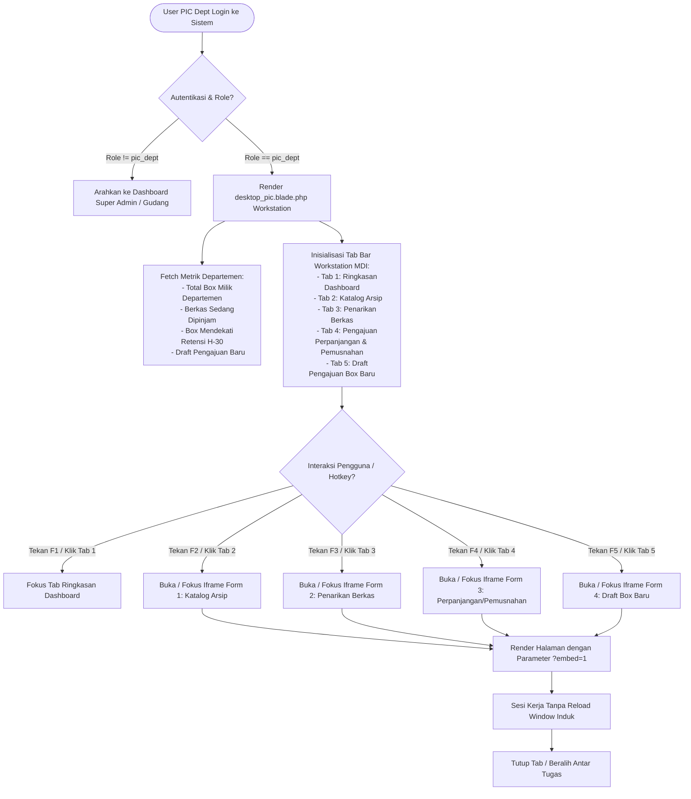

# Dokumentasi Fitur: Dashboard Desktop Workstation PIC Departemen (Department Desktop Dashboard)

Dokumen ini menjelaskan antarmuka utama Workstation Multi-Document Interface (MDI) yang digunakan oleh PIC Departemen, mencakup tata letak tab navigasi terintegrasi (`desktop_pic.blade.php`), widget KPI arsip departemen, notifikasi jatuh tempo retensi, dan pintasan keyboard (*F1–F12*).

---

## 1. Ringkasan Fitur
- **Role Pengguna**: `pic_dept` (PIC Departemen / Sekretaris Unit Kerja)
- **Menu Akses**: `Dashboard Utama` (`/` atau `/desktop`)
- **Tujuan**:
  1. Menyediakan antarmuka kerja workstation desktop modern yang responsif tanpa perlu *page reload* penuh untuk setiap modul.
  2. Mengimplementasikan 4 Form Utama Revisi 4 melalui iframe tab (`?embed=1`):
     - **Form 1**: Katalog Arsip (`/archives?embed=1`)
     - **Form 2**: Penarikan Berkas / Peminjaman (`/borrowings?embed=1`)
     - **Form 3**: Pengajuan Perpanjangan & Pemusnahan (`/destructions?embed=1`)
     - **Form 4**: Draft Pengajuan Box Baru (`/archives/create?embed=1`)
  3. Membatasi lingkup data (*data scoping*) hanya pada dokumen yang dimiliki oleh departemen pengguna (`where('department_id', auth()->user()->department_id)`).
  4. Menampilkan ringkasan KPI: Total Box Aktif, Berkas Sedang Dipinjam, Box Mendekati Jatuh Tempo Retensi (H-30), dan Draft Box Belum Dikirim.

---

## 2. Alur Kerja (Flowchart Navigasi Desktop MDI PIC Departemen)

---

## 3. Komponen Teknis (Backend & Frontend)

### 3.1 Views & Controller
- **Controller**: [HomeController.php](file:///c:/laragon/www/%23Project2026/indraco-arsip-laravel-7/app/Http/Controllers/HomeController.php) atau [DashboardController.php](file:///c:/laragon/www/%23Project2026/indraco-arsip-laravel-7/app/Http/Controllers/DashboardController.php)
- **Blade Views**:
  - `resources/views/desktop_pic.blade.php`: Shell workstation desktop utama untuk PIC Departemen.
  - `resources/views/layouts/app.blade.php`: Layout dasar (menyembunyikan header/sidebar jika `request()->has('embed')`).

### 3.2 Pemetaan Pintasan Tombol (Keyboard Shortcuts)
| Tombol | Fungsi Workstation | Target Endpoint Embed |
|---|---|---|
| **F1** | Beranda & Ringkasan Metrik | `/home` |
| **F2** | Form 1: Katalog Arsip Departemen | `/archives?embed=1` |
| **F3** | Form 2: Peminjaman & Penarikan Berkas | `/borrowings?embed=1` |
| **F4** | Form 3: Perpanjangan & Pemusnahan | `/destructions?embed=1` |
| **F5** | Form 4: Registrasi / Draft Box Baru | `/archives/create?embed=1` |
| **Ctrl + W** | Tutup Tab Aktif | Menutup iframe yang sedang fokus |
| **Ctrl + Tab** | Berpindah ke Tab Berikutnya | Siklus tab aktif |

---

## 4. Langkah Operasional PIC Departemen

1. **Masuk ke Sistem**:
   - Login menggunakan akun departemen (contoh: PIC Purchasing, PIC HRD, PIC Marketing).
   - Sistem langsung membuka desktop workstation terintegrasi.
2. **Memeriksa Notifikasi Kritis**:
   - Amati widget banner di bagian atas. Jika ada arsip yang berstatus *H-30 Menuju Jatuh Tempo Retensi*, klik link notifikasi tersebut untuk langsung diarahkan ke **Form 3 (Perpanjangan/Pemusnahan)**.
3. **Membuka Modul Kerja**:
   - Klik tab menu atau gunakan hotkey `F2`–`F5` untuk membuka formulir yang ingin dikerjakan.
   - Setiap formulir akan terbuka dalam sub-jendela tab independen sehingga PIC Departemen dapat menginput box baru sambil tetap membuka referensi nomor arsip di tab katalog.
