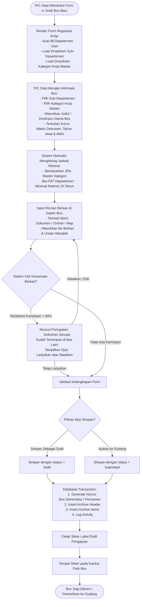

# Dokumentasi Fitur: Pembuatan & Pendaftaran Box Baru (Archive Creation & Registration)

Dokumen ini menjelaskan alur operasional PIC Departemen dalam mendaftarkan box arsip baru melalui **Form 4: Draft Pengajuan Box Baru** (`/archives/create?embed=1`), pemilihan sub-departemen, kategori arsip master, input multi-item berkas dalam box, serta mekanisme pencegahan duplikasi data (*similarity check*).

---

## 1. Ringkasan Fitur
- **Role Pengguna**: `pic_dept` (PIC Departemen)
- **Menu Akses**: `Workstation Form 4` > `Draft Pengajuan Box Baru` (`/archives/create?embed=1` atau Hotkey **F5**)
- **Tujuan**:
  1. Mendaftarkan kardus box arsip fisik baru sebelum diserahkan ke gudang sentral Indraco.
  2. Mengaitkan box dengan **Sub-Departemen** yang presisi dan **Master Kategori Arsip**.
  3. Memasukkan daftar berkas/dokumen fisik yang tersimpan di dalam kardus (*Archive Items*), termasuk nomor ordner, perihal berkas, dan kurun waktu (tahun awal - tahun akhir).
  4. Menjalankan algoritma pendeteksi kesamaan (*Similarity Check*) untuk memperingatkan pengguna jika nomor dokumen atau perihal yang diinput memiliki kemiripan tinggi dengan arsip yang sudah tersimpan sebelumnya.
  5. Menyimpan draft pengajuan box dan mencetak stiker sementara (draft sticker).

---

## 2. Alur Kerja (Flowchart Pembuatan & Registrasi Box Baru)

---

## 3. Komponen Teknis (Backend & Database)

### 3.1 Controller & Routing
- **Controller**: [ArchiveController.php](file:///c:/laragon/www/%23Project2026/indraco-arsip-laravel-7/app/Http/Controllers/ArchiveController.php)
- **Route Endpoint**:
  - `GET /archives/create`: Form pembuatan box baru (`?embed=1` untuk mode desktop).
  - `POST /archives`: Menyimpan draft pengajuan box baru beserta item berkas.
  - `POST /archives/check-similarity`: Endpoint AJAX untuk memvalidasi kemiripan judul berkas dengan arsip yang sudah ada di database.

### 3.2 Eloquent Models Terkait
- [Archive.php](file:///c:/laragon/www/%23Project2026/indraco-arsip-laravel-7/app/Models/Archive.php)
  - Atribut: `box_number`, `department_id`, `sub_department_id`, `category_id`, `title`, `description`, `year_start`, `year_end`, `retention_years`, `expiry_year`, `status` (`draft`/`submitted`), `created_by`.
- [ArchiveItem.php](file:///c:/laragon/www/%23Project2026/indraco-arsip-laravel-7/app/Models/ArchiveItem.php)
  - Atribut: `archive_id`, `item_number`, `document_number`, `title`, `description`, `document_date`.
- [ArchiveCategory.php](file:///c:/laragon/www/%23Project2026/indraco-arsip-laravel-7/app/Models/ArchiveCategory.php)

---

## 4. Langkah Operasional PIC Departemen

1. **Buka Formulir**:
   - Di workstation MDI, tekan **F5** atau klik tab **Draft Pengajuan Box Baru**.
2. **Isi Data Identitas Box**:
   - Pilih Sub-Departemen (contoh: *Finance - Account Payable*).
   - Pilih Kategori Arsip (contoh: *Faktur Pajak Masukan*).
   - Masukkan judul box, misalnya: `Voucher Pembayaran Bank Bulan Januari-Maret 2024`.
   - Masukkan rentang tahun berkas: `2024` s/d `2024`.
3. **Periksa Otomatisasi Retensi**:
   - Sistem langsung menampilkan masa simpan (contoh: 10 tahun untuk Finance & Tax), dan tahun kedaluwarsa secara otomatis (`2034`).
4. **Input Rincian Berkas Dalam Box**:
   - Klik tombol **+ Tambah Berkas / Ordner**.
   - Masukkan nomor berkas dan judul masing-masing ordner (contoh: `Ordner 01 - Bank BCA IDR`, `Ordner 02 - Bank Mandiri USD`).
5. **Simpan & Cetak Label**:
   - Klik **Simpan & Ajukan ke Gudang**.
   - Klik tombol **Cetak Stiker Draft** (ukuran 100mm $\times$ 150mm).
   - Tempel stiker pada sisi muka kardus standar TB 30g, lalu siapkan box untuk diantar ke gudang arsip.
