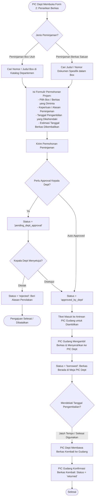

# Dokumentasi Fitur: Penarikan & Peminjaman Berkas (Document Retrieval & Borrowing)

Dokumen ini menjelaskan alur operasional PIC Departemen dalam mengajukan permohonan peminjaman box arsip atau berkas spesifik melalui **Form 2: Penarikan Berkas** (`/borrowings?embed=1`), alur persetujuan internal kepala departemen, hingga pemantauan masa pinjam berkas aktif.

---

## 1. Ringkasan Fitur
- **Role Pengguna**: `pic_dept` (PIC Departemen)
- **Menu Akses**: `Workstation Form 2` > `Penarikan Berkas` (`/borrowings?embed=1` atau Hotkey **F3**)
- **Tujuan**:
  1. Mengajukan pinjaman box arsip utuh atau berkas spesifik (*file level*) yang tersimpan di gudang sentral Indraco.
  2. Memilih dokumen langsung dari katalog arsip departemen tanpa harus mengingat nomor rak/slot gudang.
  3. Memasukkan alasan keperluan peminjaman (Audit Internal, Klaim Asuransi, Legal Dispute, Operasional Harian).
  4. Menetapkan tanggal estimasi pengembalian berkas.
  5. Memperoleh persetujuan (*approval*) dari Kepala Departemen / Manager sebelum diteruskan ke PIC Gudang.
  6. Memantau status peminjaman berkas (Menunggu Persetujuan, Siap Diambil di Gudang, Sedang Dipinjam, Selesai Dikembalikan).

---

## 2. Alur Kerja (Flowchart Pengajuan Peminjaman Berkas oleh PIC Dept)

---

## 3. Komponen Teknis (Backend & Database)

### 3.1 Controller & Routing
- **Controller**: [BorrowingController.php](file:///c:/laragon/www/%23Project2026/indraco-arsip-laravel-7/app/Http/Controllers/BorrowingController.php)
- **Route Endpoint**:
  - `GET /borrowings`: Daftar transaksi peminjaman departemen pengguna (`?embed=1`).
  - `GET /borrowings/create`: Formulir pengajuan peminjaman baru.
  - `POST /borrowings`: Menyimpan tiket permohonan pinjam berkas.
  - `POST /borrowings/{borrowing}/dept-approve`: Aksi persetujuan oleh Kepala Departemen.
  - `POST /borrowings/{borrowing}/cancel`: Pembatalan tiket pinjaman oleh pemohon.

### 3.2 Eloquent Models Terkait
- [Borrowing.php](file:///c:/laragon/www/%23Project2026/indraco-arsip-laravel-7/app/Models/Borrowing.php)
  - Atribut: `borrow_code`, `department_id`, `archive_id`, `archive_item_id`, `borrower_id`, `reason`, `borrow_date`, `expected_return_date`, `status` (`pending`, `approved`, `borrowed`, `returned`, `rejected`).
- [Archive.php](file:///c:/laragon/www/%23Project2026/indraco-arsip-laravel-7/app/Models/Archive.php)
- [ArchiveItem.php](file:///c:/laragon/www/%23Project2026/indraco-arsip-laravel-7/app/Models/ArchiveItem.php)

---

## 4. Langkah Operasional PIC Departemen

1. **Akses Formulir**:
   - Tekan **F3** pada workstation MDI untuk membuka tab **Form 2: Penarikan Berkas**.
2. **Buat Pengajuan Baru**:
   - Klik tombol **+ Ajukan Peminjaman Berkas**.
   - Cari dokumen yang dibutuhkan berdasarkan kata kunci nomor kontrak atau faktur.
   - Pilih apakah ingin meminjam **Satu Box Penuh** atau **Hanya Satu Berkas/Ordner Tertentu**.
3. **Lengkapi Kebutuhan**:
   - Tulis alasan pinjam (contoh: *Pemeriksaan Pajak Tahunan oleh BDO Indonesia*).
   - Tentukan tanggal perkiraan berkas dikembalikan (maksimal rekomendasi 14 hari kerja).
4. **Kirim Pengajuan**:
   - Klik tombol **Kirim Permohonan**. Tiket akan berstatus *Menunggu Persetujuan Kepala Departemen*.
5. **Pengambilan Berkas**:
   - Setelah status berubah menjadi *Siap Diambil di Gudang*, PIC Dept dapat mendatangi loket gudang arsip sentral untuk mengambil berkas fisik dengan memperlihatkan kode barcode pinjaman.
