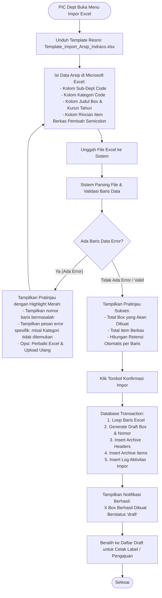

# Dokumentasi Fitur: Impor Arsip Massal via Excel (Bulk Archive Excel Import)

Dokumen ini menjelaskan alur operasional PIC Departemen dalam melakukan pendaftaran ratusan box arsip lama (*backlog archives*) secara serentak menggunakan template spreadsheet Excel (.xlsx / .csv), validasi integritas kolom, pratinjau data (*preview grid*), hingga eksekusi pemuatan data ke dalam form draft.

---

## 1. Ringkasan Fitur
- **Role Pengguna**: `pic_dept` (PIC Departemen)
- **Menu Akses**: `Workstation Form 4` > `Tombol Import Excel` (`/archives/import`)
- **Tujuan**:
  1. Mempercepat digitalisasi data arsip inaktif departemen dalam jumlah puluhan hingga ratusan box tanpa perlu input manual satu per satu.
  2. Menyediakan template resmi Excel yang sudah terstandarisasi dengan kode sub-departemen dan kode kategori arsip.
  3. Memvalidasi baris data sebelum disimpan ke database:
     - Memastikan format tahun 4 digit valid (e.g. `2020`).
     - Memastikan tahun akhir $\ge$ tahun awal.
     - Memeriksa keabsahan kode kategori arsip.
     - Memastikan departemen sesuai dengan hak akses user.
  4. Menampilkan tabel *Data Preview* dengan penanda baris error berwarna merah bila ada field yang tidak sesuai validasi.
  5. Melakukan migrasi data secara massal menjadi kumpulan draft pengajuan box baru.

---

## 2. Alur Kerja (Flowchart Impor Arsip Massal via Excel)

---

## 3. Komponen Teknis (Backend & Parser)

### 3.1 Controller & Routing
- **Controller**: [ArchiveImportController.php](file:///c:/laragon/www/%23Project2026/indraco-arsip-laravel-7/app/Http/Controllers/ArchiveImportController.php) atau [ArchiveController.php](file:///c:/laragon/www/%23Project2026/indraco-arsip-laravel-7/app/Http/Controllers/ArchiveController.php)
- **Route Endpoint**:
  - `GET /archives/import/template`: Unduh file contoh format impor `.xlsx`.
  - `POST /archives/import/preview`: Unggah file untuk divalidasi dan ditampilkan dalam tabel pratinjau.
  - `POST /archives/import/commit`: Menyimpan seluruh baris valid ke dalam tabel database `archives` dan `archive_items`.

### 3.2 Struktur Kolom Template Excel
| Kolom | Nama Field | Wajib | Contoh Nilai | Keterangan |
|---|---|---|---|---|
| A | `sub_department_code` | Ya | `FIN-AP` | Kode Sub-Departemen terdaftar |
| B | `category_code` | Ya | `INV-IN` | Kode Master Kategori Arsip |
| C | `box_title` | Ya | `Invoice Pembelian Supplier Q1 2023` | Judul utama box kardus |
| D | `year_start` | Ya | `2023` | Format 4 digit angka |
| E | `year_end` | Ya | `2023` | Format 4 digit angka ($\ge$ year_start) |
| F | `description` | Opsional | `Arsip faktur asli beserta PO & LPB` | Catatan tambahan |
| G | `items_list` | Opsional | `Ordner 01: Supplier A; Ordner 02: Supplier B` | Dipisahkan tanda titik-koma (`;`) |

---

## 4. Langkah Operasional PIC Departemen

1. **Unduh Template Resmi**:
   - Di tab pengajuan box baru, klik tombol **Impor dari Excel**.
   - Klik **Unduh Template Impor (.xlsx)**.
2. **Pengisian Data di Excel**:
   - Buka file di Microsoft Excel atau WPS Office.
   - Masukkan data sesuai panduan sheet `PETUNJUK_PENGISIAN`.
   - Simpan berkas.
3. **Upload & Pratinjau**:
   - Klik **Pilih File Excel**, pilih berkas yang sudah diisi, lalu klik **Pratinjau Data**.
   - Sistem akan memvalidasi seluruh baris data.
4. **Pemeriksaan Hasil Validasi**:
   - Jika ada baris berwarna merah, perbaiki isi kolom di Excel Anda lalu upload kembali.
   - Jika semua baris berwarna hijau, periksa ringkasan jumlah box.
5. **Eksekusi Impor**:
   - Klik tombol biru **Konfirmasi Simpan ke Draft**.
   - Sistem akan memproses seluruh baris. Seluruh box akan tersimpan dalam status `draft` dan siap dicetak stiker labelnya.
