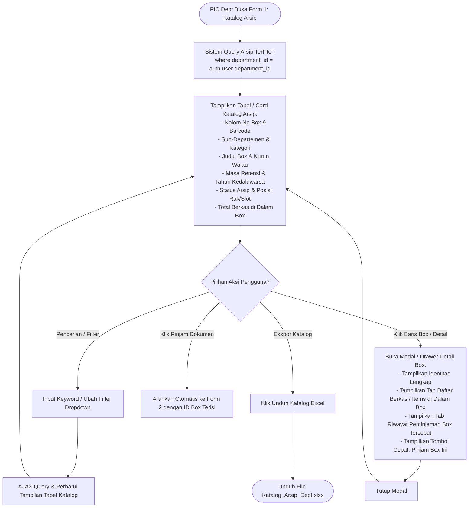

# Dokumentasi Fitur: Katalog Arsip Departemen & Pencarian Cepat (Department Archive Catalog)

Dokumen ini menjelaskan alur operasional PIC Departemen pada **Form 1: Katalog Arsip** (`/archives?embed=1`), yang menyediakan katalog visual seluruh box dan berkas fisik milik departemen yang tersimpan di gudang arsip sentral Indraco, filter dinamis, pencarian teks instan, riwayat peminjaman, serta ekspor daftar katalog ke format Excel.

---

## 1. Ringkasan Fitur
- **Role Pengguna**: `pic_dept` (PIC Departemen)
- **Menu Akses**: `Workstation Form 1` > `Katalog Arsip` (`/archives?embed=1` atau Hotkey **F2**)
- **Tujuan**:
  1. Menampilkan seluruh arsip inaktif milik departemen pengguna yang sedang tersimpan di gudang (`status = 'stored'`) maupun yang sedang berstatus draft, dipinjam, atau checkout.
  2. Menyediakan mesin pencari cepat (*live debounce search*) berdasarkan nomor box, nomor berkas, judul ordner, atau kata kunci uraian isi dokumen.
  3. Filter bertingkat berdasarkan:
     - Sub-Departemen (misal: *Finance - Tax*, *Finance - AP*, *Finance - AR*)
     - Kategori Arsip Master
     - Rentang Tahun Berkas
     - Status Arsip (`Draft`, `Disimpan di Rak`, `Sedang Dipinjam`, `Checkout`)
  4. Drawer / Modal drilldown untuk memeriksa isi kardus box hingga level lembaran/ordner berkas (*Archive Items*).
  5. Fitur ekspor daftar katalog arsip departemen ke format Excel (.xlsx) untuk kebutuhan audit berkala.

---

## 2. Alur Kerja (Flowchart Penelusuran Katalog Arsip Departemen)



---

## 3. Komponen Teknis (Backend & Query Filtering)

### 3.1 Controller & Routing
- **Controller**: [ArchiveController.php](file:///c:/laragon/www/%23Project2026/indraco-arsip-laravel-7/app/Http/Controllers/ArchiveController.php)
- **Route Endpoint**:
  - `GET /archives`: Halaman daftar katalog arsip (`?embed=1` untuk mode tab workstation).
  - `GET /archives/{archive}`: Detail data box arsip beserta relasi item berkas dan slot rak.
  - `GET /archives/export/department-catalog`: Mengunduh spreadsheet Excel katalog departemen.

### 3.2 Keamanan Data (Data Scoping Scope)
Setiap query pada level PIC Departemen diwajibkan menggunakan global scope atau pengecekan controller:
```php
public function index(Request $request)
{
    $query = Archive::with(['subDepartment', 'category', 'slot.rack', 'items'])
        ->where('department_id', auth()->user()->department_id);

    if ($request->filled('search')) {
        $search = $request->search;
        $query->where(function ($q) use ($search) {
            $q->where('box_number', 'like', "%{$search}%")
              ->orWhere('title', 'like', "%{$search}%")
              ->orWhereHas('items', function ($itemQuery) use ($search) {
                  $itemQuery->where('title', 'like', "%{$search}%")
                            ->orWhere('document_number', 'like', "%{$search}%");
              });
        });
    }

    if ($request->filled('sub_department_id')) {
        $query->where('sub_department_id', $request->sub_department_id);
    }

    $archives = $query->latest()->paginate(20);
    return view('archives.index', compact('archives'));
}
```

---

## 4. Langkah Operasional PIC Departemen

1. **Akses Katalog**:
   - Di workstation MDI, tekan tombol **F2** atau klik tab **Katalog Arsip**.
2. **Pencarian Cepat**:
   - Ketikkan nomor invoice, perihal kontrak, atau nomor box pada kolom pencarian di bagian atas.
   - Hasil pencarian akan langsung muncul secara dinamis (*real-time*).
3. **Melihat Rincian Isi Box**:
   - Klik pada nomor box atau tombol ikon mata (*Lihat Detail*).
   - Di dalam drawer rincian, periksa daftar ordner berkas untuk memastikan dokumen yang dicari memang berada di dalam kardus box tersebut.
4. **Peminjaman Cepat Langsung dari Katalog**:
   - Jika dokumen yang dicari telah ditemukan di katalog, klik tombol **Pinjam Dokumen Ini**.
   - Sistem akan langsung membuka **Form 2: Penarikan Berkas** dengan data box yang telah terisi otomatis, menghemat waktu input.
5. **Ekspor Data untuk Pelaporan**:
   - Klik tombol **Ekspor Excel** untuk mendapatkan rekapitulasi seluruh arsip departemen yang tersimpan di gudang sentral Indraco.
