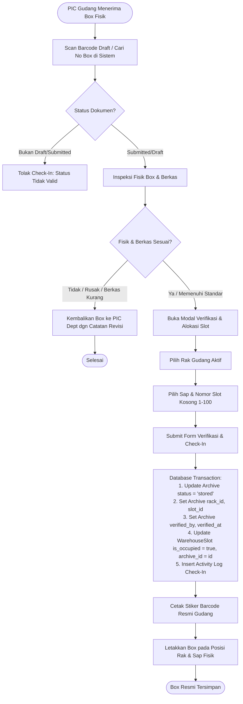

# Dokumentasi Fitur: Verifikasi Fisik & Check-In Arsip (Warehouse Check-In)

Dokumen ini menjelaskan alur operasional verifikasi kondisi fisik box arsip yang dikirimkan oleh unit kerja departemen ke gudang sentral Indraco, proses alokasi nomor rak dan slot, serta prosedur check-in fisik hingga arsip berstatus aktif tersimpan (`stored`).

---

## 1. Ringkasan Fitur
- **Role Pengguna**: `pic_gudang` (Warehouse Operator / Staff Gudang Arsip)
- **Menu Akses**: `Menu Utama` > `Verifikasi Fisik & Check-In` (`/warehouse/verification`)
- **Tujuan**:
  1. Melakukan inspeksi fisik terhadap box arsip bertiket status `draft` atau `submitted` yang diantar oleh PIC Departemen.
  2. Memastikan kelayakan box fisik (ketebalan kardus, kekeringan, kesesuaian stiker barcode draft, isi berkas di dalamnya).
  3. Memilih rak dan slot kosong (1–100) untuk penempatan permanen box arsip.
  4. Menetapkan status arsip menjadi `stored` (atau `verified`), mengunci relasi antara ID Arsip dan ID Slot Rak.
  5. Mencetak stiker barcode resmi gudang (apabila diperlukan penggantian label).

---

## 2. Alur Kerja (Flowchart Verifikasi & Check-In)

---

## 3. Komponen Teknis (Backend & Database)

### 3.1 Controller & Routing
- **Controller**: [ArchiveVerificationController.php](file:///c:/laragon/www/%23Project2026/indraco-arsip-laravel-7/app/Http/Controllers/Warehouse/ArchiveVerificationController.php) atau [ArchiveController.php](file:///c:/laragon/www/%23Project2026/indraco-arsip-laravel-7/app/Http/Controllers/ArchiveController.php)
- **Route Endpoint**:
  - `GET /warehouse/verification`: Daftar box menunggu verifikasi fisik.
  - `GET /warehouse/verification/{archive}/inspect`: Form modal inspeksi box dan pemilihan slot.
  - `POST /warehouse/verification/{archive}/verify`: Eksekusi penetapan slot dan update status arsip menjadi `stored`.
  - `POST /warehouse/verification/{archive}/reject`: Mengembalikan pengajuan box ke status draft dengan catatan penolakan.

### 3.2 Eloquent Models Terkait
- [Archive.php](file:///c:/laragon/www/%23Project2026/indraco-arsip-laravel-7/app/Models/Archive.php)
  - Atribut terupdate: `status = 'stored'`, `rack_id`, `slot_id`, `verified_by = auth()->id()`, `verified_at = now()`.
- [WarehouseRack.php](file:///c:/laragon/www/%23Project2026/indraco-arsip-laravel-7/app/Models/WarehouseRack.php)
- [WarehouseSlot.php](file:///c:/laragon/www/%23Project2026/indraco-arsip-laravel-7/app/Models/WarehouseSlot.php)
  - Atribut terupdate: `is_occupied = true`, `archive_id = $archive->id`.
- [ArchiveItem.php](file:///c:/laragon/www/%23Project2026/indraco-arsip-laravel-7/app/Models/ArchiveItem.php)
- [ArchiveLog.php](file:///c:/laragon/www/%23Project2026/indraco-arsip-laravel-7/app/Models/ArchiveLog.php)

---

## 4. Langkah Operasional PIC Gudang

1. **Penerimaan Fisik**:
   - Terima box fisik dari kurir internal / staf departemen.
   - Periksa stiker draft pada kardus (kode box, nama sub-departemen, judul arsip).
2. **Pencarian Data**:
   - Di workstation gudang, buka menu **Verifikasi Fisik & Check-In**.
   - Input atau scan barcode box draft pada search bar.
3. **Pemeriksaan Dokumen**:
   - Buka modal rincian isi box untuk memverifikasi daftar berkas/dokumen fisik di dalam map/ordner dengan data sistem.
4. **Alokasi Slot Rak**:
   - Pilih blok dan nomor rak gudang (contoh: `Rak B-04`).
   - Sistem menampilkan grid 5 sap $\times$ 20 kolom box.
   - Klik slot hijau (kosong) yang diinginkan, misal `Sap 3 - Kolom 12`.
5. **Konfirmasi & Cetak Label**:
   - Klik tombol **Verifikasi & Simpan ke Rak**.
   - Sistem mencetak label final gudang dengan QR Code / Barcode resolusi tinggi.
   - Tempelkan label permanen di sisi depan dan samping kanan box kardus standar.
6. **Peletakan Fisik**:
   - Bawa box ke lorong rak bersangkutan dan tempatkan pada sap dan kolom yang telah didaftarkan.
