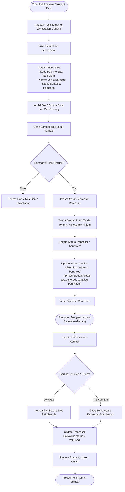

# Dokumentasi Fitur: Pemenuhan Peminjaman & Pengambilan Berkas (Borrowing Fulfillment & Dispatch)

Dokumen ini menjelaskan alur operasional PIC Gudang dalam melayani permintaan peminjaman arsip (box utuh atau berkas satuan) yang telah disetujui oleh Kepala Departemen terkait, mencakup proses pencetakan *picking list*, pengambilan fisik dari rak, serah terima berkas, hingga pemrosesan pengembalian berkas.

---

## 1. Ringkasan Fitur
- **Role Pengguna**: `pic_gudang` (Warehouse Operator)
- **Menu Akses**: `Menu Utama` > `Peminjaman & Pengambilan` (`/warehouse/borrowings` atau `/borrowings`)
- **Tujuan**:
  1. Menerima antrean tiket permohonan pinjam berkas yang berstatus `approved_by_dept`.
  2. Mencetak Lembar Pengambilan Berkas (*Picking List*) yang mencantumkan lokasi rak, sap, dan kolom secara presisi.
  3. Mengambil box/berkas dari rak fisik dan melakukan serah terima kepada pemohon (atau kurir internal).
  4. Memperbarui status transaksi menjadi `dispatched` / `borrowed`.
  5. Menerima pengembalian berkas, melakukan inspeksi fisik kelengkapan dokumen, dan mengembalikan berkas ke slot rak asalnya (`returned`).

---

## 2. Alur Kerja (Flowchart Pemenuhan Peminjaman & Pengembalian)

---

## 3. Komponen Teknis (Backend & Database)

### 3.1 Controller & Routing
- **Controller**: [BorrowingController.php](file:///c:/laragon/www/%23Project2026/indraco-arsip-laravel-7/app/Http/Controllers/BorrowingController.php) atau [WarehouseBorrowingController.php](file:///c:/laragon/www/%23Project2026/indraco-arsip-laravel-7/app/Http/Controllers/Warehouse/WarehouseBorrowingController.php)
- **Route Endpoint**:
  - `GET /borrowings?status=approved_by_dept`: Antrean tiket siap ambil.
  - `GET /borrowings/{borrowing}/picking-list`: Cetak lembar pengambilan rak (PDF/Thermal/A4).
  - `POST /borrowings/{borrowing}/dispatch`: Konfirmasi penyerahan berkas ke pemohon.
  - `POST /borrowings/{borrowing}/return`: Konfirmasi penerimaan kembali dan pengembalian ke rak.

### 3.2 Eloquent Models Terkait
- [Borrowing.php](file:///c:/laragon/www/%23Project2026/indraco-arsip-laravel-7/app/Models/Borrowing.php)
  - Atribut: `borrow_code`, `archive_id`, `archive_item_id`, `user_id`, `status` (`pending`, `approved`, `borrowed`, `returned`, `overdue`), `borrow_date`, `expected_return_date`, `actual_return_date`, `dispatched_by`.
- [Archive.php](file:///c:/laragon/www/%23Project2026/indraco-arsip-laravel-7/app/Models/Archive.php)
- [WarehouseSlot.php](file:///c:/laragon/www/%23Project2026/indraco-arsip-laravel-7/app/Models/WarehouseSlot.php)

---

## 4. Langkah Operasional PIC Gudang

1. **Memeriksa Antrean Siap Ambil**:
   - Di dashboard gudang, klik tab **Peminjaman Siap Diambil**.
   - Klik tiket untuk melihat pemohon, kebutuhan berkas, dan tanggal pengembalian.
2. **Cetak Picking List**:
   - Klik tombol **Cetak Lembar Ambil (Picking List)**.
   - Perhatikan lokasi rak (contoh: `Rak A-02, Sap 4, Slot 15`).
3. **Pengambilan di Rak**:
   - Ambil kardus box dari rak yang tertera.
   - Jika yang dipinjam adalah berkas satuan (*item level*), buka kardus dan ambil map dokumen yang diminta, lalu beri tanda *outcard* sementara di dalam box.
4. **Serah Terima**:
   - Pemohon datang ke loket gudang arsip.
   - Scan barcode box/berkas pada sistem untuk mengonfirmasi kebenaran berkas.
   - Pemohon menandatangani form serah terima. Klik tombol **Konfirmasi Penyerahan (Dispatch)**.
5. **Penerimaan Pengembalian**:
   - Saat pemohon mengembalikan dokumen, buka menu **Pengembalian Arsip**.
   - Periksa kelengkapan fisik lembaran dokumen.
   - Letakkan kembali berkas ke dalam box kardusnya, lalu kembalikan box ke slot rak gudang.
   - Klik tombol **Konfirmasi Berkas Kembali (Return)** untuk menutup tiket peminjaman.
