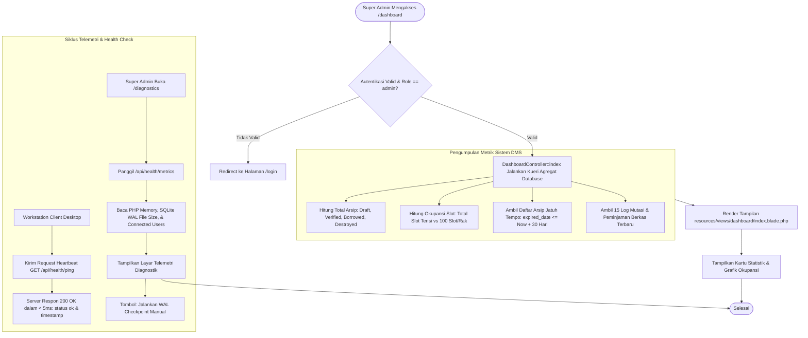

# Modul Dashboard Global & Telemetri Server (Super Admin)

## 1. Deskripsi Fitur
Modul Dashboard Global & Telemetri Server menyajikan pusat kendali operasional dan kesehatan infrastruktur sistem DMS PT Indraco. Super Admin dapat memantau:
1. **Metrik Agregat Arsip:** Total arsip aktif, arsip terverifikasi di rak gudang, status peminjaman berkas, serta arsip yang telah dimusnahkan.
2. **Kapasitas & Okupansi Rak Fisik:** Persentase slot rak terisi vs slot kosong pada gudang fisik (cth: Gudang Dokumen G.K 678).
3. **Peringatan Jatuh Tempo (H-30 Expiry Alert):** Pemantauan otomatis arsip yang masa simpannya segera berakhir dalam 30 hari ke depan.
4. **Telemetri Server LAN & Heartbeat:** Pemantauan status server web lokal, penggunaan memori PHP, WAL checkpoint status SQLite, latency endpoint ping, serta daftar pengguna yang sedang terhubung (*connected users*).

---

## 2. Hak Akses & Role Permission
- **Role:** `admin` (Super Admin / Webdev)
- **Middleware:** `auth`, `role:admin`, dan `diagnostics.auth` untuk endpoint telemetri kritis.
- **Wewenang:** Akses metrik lintas seluruh 29 departemen tanpa batasan.

---

## 3. Komponen Teknis & Skema Database

### File Terkait:
- Controller Dashboard: [DashboardController.php](file:///C:/laragon/www/%23Project2026/indraco-arsip-laravel-7/app/Http/Controllers/DashboardController.php) (Metode `index()`, `searchApi()`, `realtimeCheck()`, `apiExpiringList()`)
- Controller Diagnostik: [HealthController.php](file:///C:/laragon/www/%23Project2026/indraco-arsip-laravel-7/app/Http/Controllers/HealthController.php) (Metode `ping()`, `metrics()`, `connectedUsers()`, `checkpointWal()`, `diagnosticsView()`)
- View: `resources/views/dashboard/index.blade.php` dan `resources/views/diagnostics/index.blade.php`
- Route:
  - `GET /` atau `GET /dashboard` (`name('dashboard')`)
  - `GET /api/health/ping` (`name('api.health.ping')`)
  - `GET /api/health/metrics` (`name('api.health.metrics')`)
  - `GET /api/health/connected-users` (`name('api.health.connected_users')`)
  - `GET /diagnostics` (`name('diagnostics.index')`)

### Endpoint Stateless LAN Ping:
Endpoint `/api/health/ping` sengaja dioperasikan tanpa middleware session locking dan CSRF agar klien workstation desktop dapat melakukan heartbeat cepat setiap 10 detik tanpa membebani thread session Laravel:
```php
Route::get('/api/health/ping', 'HealthController@ping')
    ->withoutMiddleware([
        StartSession::class,
        VerifyCsrfToken::class,
        EncryptCookies::class
    ]);
```

---

## 4. Flowchart Alur Kerja Dashboard & Diagnostik Server



---

## 5. Rincian Antarmuka & Tindakan Super Admin

1. **Memantau Kartu Statistik:**
   - **Total Arsip Terdaftar:** Jumlah seluruh box yang telah tercatat di sistem.
   - **Arsip di Rak Gudang (*Stored*):** Box yang telah melalui verifikasi fisik dan menempati slot rak permanen.
   - **Sedang Dipinjam (*Borrowed*):** Berkas yang sedang berada di tangan staf departemen.
   - **Arsip Dimusnahkan (*Destroyed*):** Arsip yang telah tuntas dihancurkan dan memiliki dokumen BAP sah.
2. **Memeriksa Status Koneksi Workstation:**
   - Masuk ke menu **Diagnostik Server** (`/diagnostics`).
   - Periksa daftar alamat IP workstation yang sedang aktif membuka aplikasi.
   - Jika file jurnal SQLite membesar, klik tombol **Jalankan WAL Checkpoint** untuk merapikan penyimpanan database lokal.
