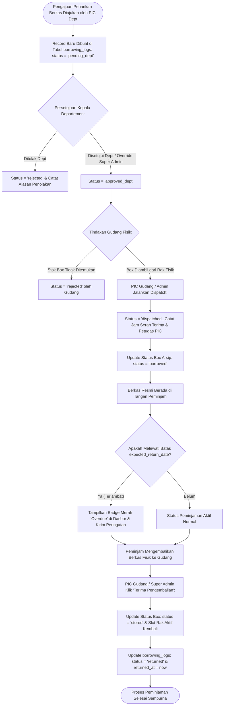

# Modul Pengawasan Penarikan & Peminjaman Berkas (Super Admin)

## 1. Deskripsi Fitur
Modul Pengawasan Penarikan Berkas (*Borrowing & Document Retrieval Oversight*) mengendalikan seluruh sirkulasi berkas fisik yang dikeluarkan dari rak gudang untuk keperluan audit, operasional harian departemen, atau kebutuhan legal. 

Super Admin memiliki wewenang eksekutif untuk:
1. Memantau seluruh peminjaman aktif lintas 29 departemen.
2. Melakukan intervensi persetujuan (*Global Approval & Reject Override*) jika pejabat departemen atau staf gudang berhalangan.
3. Melacak berkas yang terlambat dikembalikan (*Overdue Borrowings*) melebihi batas tanggal estimasi kembali (*expected_return_date*).
4. Mengesahkan penerimaan pengembalian berkas (*Return Verification*) dan mengembalikan status fisik box ke rak gudang.

---

## 2. Hak Akses & Role Permission
- **Role:** `admin` (Super Admin)
- **Middleware:** `auth`, `role:admin`
- **Fokus Pengawasan:** Menjamin akuntabilitas fisik dokumen agar tidak ada berkas yang hilang, rusak, atau berpindah tangan tanpa rekam jejak resmi.

---

## 3. Komponen Teknis & Skema Database

### File Terkait:
- Controller: [BorrowingController.php](file:///C:/laragon/www/%23Project2026/indraco-arsip-laravel-7/app/Http/Controllers/BorrowingController.php)
  - `index()`: Daftar seluruh pengajuan penarikan berkas.
  - `deptApprove()`: Persetujuan kepala departemen asal.
  - `approve()`: Otorisasi kesiapan berkas oleh gudang.
  - `dispatch()`: Serah terima berkas fisik ke peminjam.
  - `returnArchive()`: Penerimaan kembali dan verifikasi keutuhan berkas.
- Model: [BorrowingLog.php](file:///C:/laragon/www/%23Project2026/indraco-arsip-laravel-7/app/Models/BorrowingLog.php)
- View: `resources/views/borrowings/index.blade.php`, `resources/views/borrowings/modals/dispatch_modal.blade.php`, `resources/views/borrowings/modals/reject_modal.blade.php`
- Route:
  - `GET /borrowings` (`name('borrowings.index')`)
  - `POST /borrowings/{borrowing}/dept-approve` (`name('borrowings.dept_approve')`)
  - `POST /borrowings/{borrowing}/approve` (`name('borrowings.approve')`)
  - `POST /borrowings/{borrowing}/dispatch` (`name('borrowings.dispatch')`)
  - `POST /borrowings/{borrowing}/return` (`name('borrowings.return')`)

### Tahapan Status Peminjaman (*Borrowing Status Transition*):
```
[ pending_dept ] ──► [ approved_dept ] ──► [ dispatched (Sedang Dipinjam) ] ──► [ returned (Selesai) ]
       │                      │
       ▼                      ▼
  [ rejected ]           [ rejected ]
```

---

## 4. Flowchart Alur Pengawasan Sirkulasi Peminjaman Berkas



---

## 5. Rincian Antarmuka & Langkah Kerja Super Admin

1. Akses menu **Penarikan Berkas** (`/borrowings`).
2. **Memantau Berkas Jatuh Tempo (*Overdue Tracking*):**
   - Perhatikan tab **Terlambat / Overdue**. Baris data dengan warna merah menandakan peminjam belum mengembalikan berkas melebihi tanggal janji kembali.
   - Super Admin dapat melihat kontak nama peminjam, ekstensi telepon, dan nomor box untuk melakukan teguran langsung.
3. **Eksekusi Pengembalian Darurat:**
   - Jika staf gudang berhalangan, Super Admin dapat mengklik tombol **Terima Kembali** pada baris peminjaman.
   - Masukkan catatan kondisi berkas (misal: *"Berkas lengkap tanpa kerusakan"*).
   - Sistem seketika mengembalikan status box menjadi `stored` pada slot rak asal.
