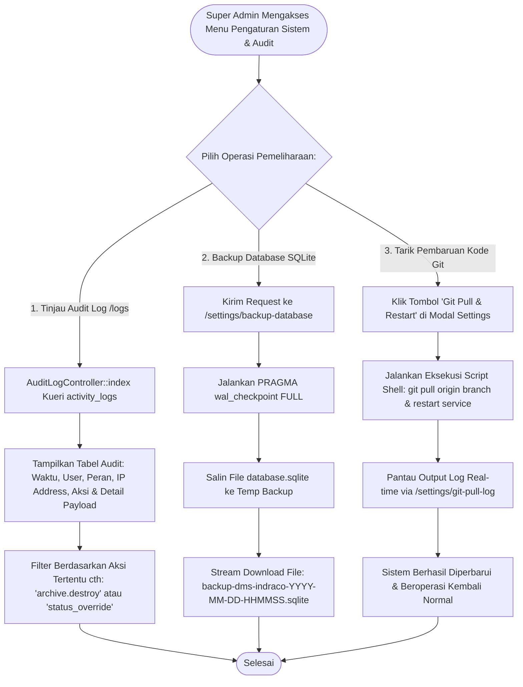

# Modul Audit Trail & Pemeliharaan Database (Super Admin)

## 1. Deskripsi Fitur
Modul Audit Trail & Pemeliharaan Database merupakan instrumen tertinggi bagi Super Admin (Webdev / IT Administrator) untuk menjaga keandalan, integritas data, dan kelangsungan operasional sistem DMS PT Indraco.

Fitur Utama:
1. **Pusat Rekam Jejak Audit Global (*Global Audit Trail*):** Mencatat setiap aktivitas penting sistem (login, pembuatan box, verifikasi, sirkulasi peminjaman, pemusnahan, override status, perubahan setting) lengkap dengan alamat IP pengguna dan data perubahan (*payload diff*).
2. **Pencadangan Database Satu Sentuhan (*One-Click SQLite Database Backup*):** Mengunduh salinan berkas database SQLite secara instan untuk proteksi *disaster recovery*.
3. **Pembersihan Log & Alokasi Terjadwal (*Maintenance Tools*):** Mengosongkan log transaksi lama atau mereset alokasi box uji coba.
4. **Pembaruan Kode Tanpa Henti (*Hot Git Pull & Restart Feature*):** Menarik pembaruan kode Git terbaru dari repository dan merestart server workstation secara otomatis via antarmuka web (`/settings/git-pull-restart`).
5. **Kustomisasi Identitas Perusahaan (*System Branding & Logo Settings*):** Mengunggah logo resmi perusahaan dan mengatur kop surat dokumen.

---

## 2. Hak Akses & Role Permission
- **Role:** `admin` (Eksklusif Super Admin / Webdev)
- **Middleware:** `auth`, `role:admin`
- **Tingkat Keamanan:** Fungsi pemeliharaan database dilindungi otorisasi ganda untuk mencegah kehilangan data akibat ketidaksengajaan.

---

## 3. Komponen Teknis & Skema Database

### File Terkait:
- Controller Audit: [AuditLogController.php](file:///C:/laragon/www/%23Project2026/indraco-arsip-laravel-7/app/Http/Controllers/AuditLogController.php)
- Controller Pemeliharaan: [SettingController.php](file:///C:/laragon/www/%23Project2026/indraco-arsip-laravel-7/app/Http/Controllers/SettingController.php)
- Model:
  - [ActivityLog.php](file:///C:/laragon/www/%23Project2026/indraco-arsip-laravel-7/app/Models/ActivityLog.php)
  - [AppSetting.php](file:///C:/laragon/www/%23Project2026/indraco-arsip-laravel-7/app/Models/AppSetting.php)
- View: `resources/views/logs/index.blade.php`, `resources/views/layouts/partials/system_settings_modal.blade.php`
- Route:
  - `GET /logs` (`name('logs.index')`)
  - `GET|POST /settings/backup-database` (`name('settings.backup_database')`)
  - `POST /settings/clear-logs` (`name('settings.clear_logs')`)
  - `POST /settings/git-pull-restart` (`name('settings.git_pull_restart')`)
  - `GET /settings/git-pull-log` (`name('settings.git_pull_log')`)
  - `POST /settings/update` (`name('master.settings.update')`)

---

## 4. Flowchart Alur Audit Trail & Pemeliharaan Sistem

---

## 5. Rincian Antarmuka & Langkah Kerja Super Admin

1. **Mencadangkan Database Rutin (*Weekly Backup*):**
   - Klik tombol **Pengaturan Sistem** (ikon roda gigi) di header desktop.
   - Klik tombol **Backup Database SQLite Sekarang**.
   - Browser akan langsung mengunduh file `.sqlite` utuh yang siap dipulihkan kapan saja.
2. **Pembaruan Kode via Git:**
   - Jika terdapat patch perbaikan bug dari tim pengembang, klik **Tarik Pembaruan (Git Pull)**.
   - Modal akan menampilkan log konsol penarikan berkas. Sistem akan memuat ulang cache dan memperbarui aplikasi tanpa harus membuka terminal server secara manual.
